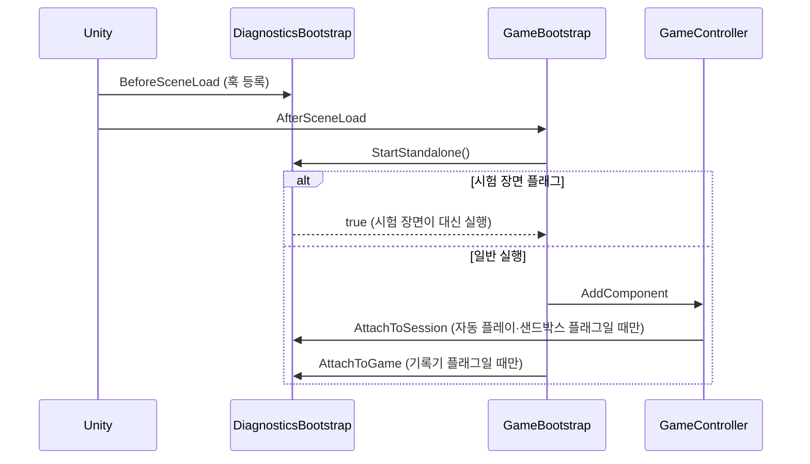
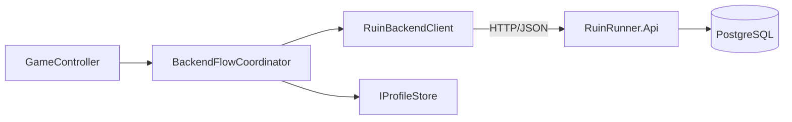

# Ruin Runner 구조

## 어셈블리

| 어셈블리 | 참조 | 설명 |
| --- | --- | --- |
| `RuinRunner.Generation` | 없음 (`noEngineReferences`) | 지역 그래프 생성과 기하 검증. 서버 프로젝트 `Backend/RuinRunner.Generation`이 같은 파일을 링크해 컴파일한다. |
| `RuinRunner.Backend` | Newtonsoft.Json | REST 클라이언트, 원정 흐름 조정, 요청 저널과 로컬 자격 정보 보호 |
| `RuinRunner.Runtime` | Generation, Backend, Pixel Perfect | 게임 본체 |
| `RuinRunner.Diagnostics` | Runtime, Generation, Backend | 자동 검증, 시험 장면, 기록기 |
| `RuinRunner.Editor` | 위 전부 | 에디터 메뉴, 임포트 처리, 편집 창 |

의존은 한 방향으로만 흐릅니다. `Backend`는 저장 시스템을 직접 알지 않고 `IProfileStore` 인터페이스로 서버 프로필을 넘깁니다(`SaveSlotService`가 구현). `Runtime`은 검증 코드를 참조하지 않고, `DiagnosticsHooks`의 빈 확장 지점만 둡니다. `Diagnostics`가 `BeforeSceneLoad` 시점에 훅을 채우므로 검증 어셈블리를 빼도 게임은 그대로 실행됩니다.

## 실행 흐름

`Demo.unity` 씬에는 게임 오브젝트가 없습니다. `GameBootstrap`이 물리 설정(60Hz 고정 틱, 중력 0)을 하고 `GameController`를 만듭니다.

## GameController

메뉴·마을·원정·결과를 하나의 상태 기계(`GameSessionPhase`: MainMenu, Town, Expedition, BossIntro, Result, Paused, Transition)로 관리합니다. 역할별 partial 파일로 나뉩니다.

| 파일 | 역할 |
| --- | --- |
| `GameController.cs` | 상태와 초기화, 메뉴·옵션 |
| `GameController.Run.cs` | 원정 시작, 구역 입장, 웨이브, 보상 상자, 스테이지 클리어 |
| `GameController.Loadout.cs` | 성장 선택, 가방 포커스, 무기 슬롯 |
| `GameController.Flow.cs` | 매 프레임 입력, 일시정지, 사망, 메뉴 복귀 |
| `GameController.TimeEffects.cs` | 히트스톱과 슬로 모션 |
| `GameController.Town.cs`, `.Session.cs` | 마을, 출정·정산 |
| `GameController.Economy.cs`, `.Equipment.cs`, `.FieldServices.cs` | 상점, 장비, 현장 시설 |
| `GameController.Backend.cs` | 서버 연결 |
| `CampaignProgression.cs` | 스테이지 전환 |

한 원정 동안 `PlayerController`, `PlayerStats`, `InventorySystem`, `PlayerProgression`, `RunStats`는 같은 인스턴스를 유지합니다. 스테이지 전환은 지형·적·투사체·장벽을 교체하고 같은 플레이어를 새 시작점으로 옮깁니다. 비동기 콜백은 전환 시점의 `stageEpoch`를 비교해 이전 스테이지에서 실행되지 않게 합니다.

## 지역 생성

1. `ProceduralStageGenerator.Generate(seed, stage)`가 공간 모듈을 골라 구역 그래프(`GeneratedStage`)를 만든다.
2. `GeneratedStageGeometry.Validate`가 겹침·연결·도달 가능성을 검사한다. 실패하면 같은 시드의 다음 시도로 다시 만든다.
3. `GeneratedStageUnityAdapter`가 그래프를 `RoomTemplate`과 `StageLayoutDefinition`으로 바꾼다.
4. `DungeonMap.BuildStage`가 하나의 월드를 만들고, 같은 통행 마스크를 렌더링·충돌·길찾기(`StageNavigation`)·지도에 쓴다.

구역은 안정적인 ID와 역할(전투, 상인, 현장 시설, 보스)을 가지며, 출입·봉쇄·재방문 조건은 그래프의 연결 정보로 판단합니다. 서버는 같은 생성 코드로 원정 시드를 고정하고 기록합니다.

## 전투

- 입력은 `GameSettingsService`의 `GameAction`을 거칩니다. 자동 플레이는 `StageValidationInput`이 같은 경로로 값을 공급합니다.
- `PlayerController`는 `Input`, `Attacks`, `Damage`, `Equipment` partial과 `CombatActions` 폴더의 무기 행동·콤보·스킬 partial로 나뉩니다.
- 무기 70종의 우클릭 스킬은 `PlayerController.SignatureSkills*.cs`에 있습니다. 첫 입력(`SigCast`), 두 번째 입력(`SigRecast`), 매 프레임 처리(`SigTick`), 일반 공격에 대한 반응(`SigOnMeleeHit` 등)으로 파일을 나눴습니다. 무기 정의는 `Tools/Art/weapons70.json`에서 생성한 `SignatureWeaponCatalog`입니다.
- `MeleeMotionTiming`의 준비·타격·회수 진행률을 몸 동작, 손에 든 무기, 판정이 함께 씁니다. 근접 판정은 공격 범위와 겹친 몸체까지 벽 시야를 검사합니다.
- 장신구 효과는 `ItemCombatEffects`가 처리합니다. 추가 피해는 `EnemyController.TakeItemDamage`로 구분해 다른 장신구 효과를 연쇄로 일으키지 않습니다.

## 적과 보스

- `EnemyController`는 `Movement`, `Damage`, `Presentation`, `Brain`, `StageMobs` partial로 나뉩니다.
- `EnemyAiDirector`는 적 전체 위의 계층으로, 플레이어 정보(블랙보드), 공격 순번과 위치(분대), 방의 압박 강도(페이싱)를 정합니다. 개별 적은 묻기만 하고 결정은 디렉터가 합니다.
- `CampaignBossBrain`과 `BossGrandMoves`가 보스별 페이즈 패턴과 대기술을 정의하고, `ArenaHazard`가 경고 그림과 같은 모양의 판정을 만듭니다.

## 성장과 진행

- `RunRandom`은 시드·스트림·인덱스로 독립 난수를 만들어 드롭과 전투 난수가 서로 영향을 주지 않게 합니다.
- `RunContent`가 무기·장신구 추첨, 희귀도·운, 성장 선택지, 스테이지별 적 조합을 정합니다.
- `InventorySystem`은 기본 20칸, 최대 32칸 가방과 장착 3슬롯을 관리합니다. `PlayerStats`는 소유 목록이 바뀔 때마다 기본값·유산·재능·장신구·세트 효과를 다시 계산합니다.
- `MetaProgressionService`는 유산 규칙만 알고 저장 방식은 모릅니다.

## 서버와 저장

- 인증은 설치마다 발급되는 게스트 자격 정보(`/v1/auth/guest`)이며 로컬에는 Windows DPAPI로 보호해 저장합니다(`BackendPrivateStore`).
- 프로필·해금·원정·경제 기록은 서버가 확정합니다. 변경 요청은 `operationId`와 기대 revision을 함께 보내므로, 응답을 받지 못해 같은 요청을 다시 보내도 한 번만 반영됩니다. 확정 전 요청은 암호화된 저널에 남겨 재실행 후 이어서 보냅니다.
- 원정 시작 시 서버가 콘텐츠 카탈로그 버전(`Backend/Content/catalog.*.json`)과 생성 시드를 고정합니다.
- 관리자 도구의 수정은 기존 버전을 고치지 않고 `<패키지 버전>-admin-<시각>` 새 버전으로 저장한 뒤 `catalog_activation`에 기록합니다. 이후 시작하는 원정만 새 버전을 쓰고, 진행 중인 원정은 고정된 버전을 유지합니다. 관리자 카탈로그의 `enemyBalance`는 게임이 원정을 시작할 때 `GameBalance.BindCatalog`로 적용하고, `baseId`가 있는 무기는 기반 무기의 그림·스킬을 쓰는 새 무기로 묶습니다. 관리자 API는 `RR_ADMIN_TOKEN`이 있을 때만 켜지고 기본적으로 서버 PC에서만 응답합니다.
- 주요 테이블: `players`, `sessions`, `profiles`, `content_catalogs`, `runs`, `operations`, `currency_ledger`, `run_economy`, `run_items`, `run_shops`, `run_reward_events`, `run_generation`, `profile_resets`. 스키마는 `Backend/RuinRunner.Api/Migrations`의 SQL 파일 순서대로 적용됩니다.

| 메서드 | 경로 | 내용 |
| --- | --- | --- |
| POST | `/v1/auth/guest` | 게스트 인증 |
| GET, POST | `/v1/profiles` | 프로필 목록, 생성 |
| GET | `/v1/profiles/{id}` | 프로필 조회 |
| PUT | `/v1/profiles/{id}/configuration` | 시작 장비·재능 설정 |
| POST | `/v1/profiles/{id}/unlocks` | 유산으로 해금 |
| POST | `/v1/profiles/{id}/reset-challenge`, `/reset` | 두 단계 프로필 초기화 |
| POST | `/v1/runs` | 원정 시작 |
| GET | `/v1/runs/{id}`, `/economy` | 원정·경제 상태 |
| POST | `/v1/runs/{id}/trades`, `/rewards` | 거래, 보상 |
| POST | `/v1/runs/{id}/settle` | 정산 |
| GET | `/v1/catalogs/current`, `/{version}` | 콘텐츠 카탈로그 |
| GET | `/admin`, `/admin/api/state`, `/catalogs/{version}` | 관리자 페이지, 버전 목록, 편집용 카탈로그 |
| POST | `/admin/api/catalogs`, `/activate` | 수정본을 새 버전으로 저장·적용, 이전 버전 적용 |

로컬 설정(음량·화면·키)은 `GameSettingsService`가 원자적 교체와 백업 파일로 저장합니다.

## 표시

- 월드는 Built-in 렌더러와 Pixel Perfect Camera(640×360 구도, 32 PPU)로 그리며 Point 필터 원본 PNG를 씁니다.
- HUD와 메뉴는 IMGUI(`GameHud` partial: `FrontEnd`, `Run`, `Inventory`, `Result`, `Town`, `Styles`)입니다.
- 전투 이펙트는 `Tools/pixelfx`로 만든 프레임을 `Tools/Art/pixelfx-to-unity.mjs`로 내보내 `Resources/Art/Pixel/Separated/CombatFX`에 둡니다.

## 검증

`RuinRunner.Diagnostics`의 모든 검증은 명령줄 플래그로만 켜집니다.

| 플래그 | 내용 |
| --- | --- |
| `--smoke-test` (또는 batchmode) | 빌드된 플레이어의 시작·리소스·카탈로그 검사 |
| `--automated-stage-validation` | 실제 입력 경로로 원정을 끝까지 자동 플레이 |
| `--combat-sandbox` | 전투 시험 방 (`--sandbox-skills`, `--sandbox-passives`로 스킬·장신구 순회) |
| `--boss-move-tour`, `--melee-trail-tour` | 보스 대기술, 근접 궤적 촬영 |
| `--performance-dir <폴더>` | 프레임 시간 기록 |

검증 실행은 `--validation-profile --validation-profile-name <이름>`을 함께 지정해 사용자 저장 슬롯과 분리합니다.
