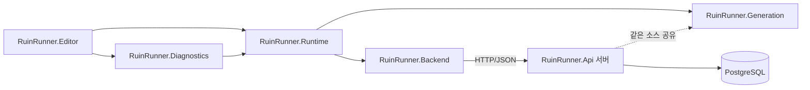

# Ruin Runner

Unity 6로 만든 탑다운 액션 로그라이트 게임과, 영구 진행을 저장하는 ASP.NET Core·PostgreSQL 서버로 이루어진 졸업작품입니다.

마을에서 시작 무기와 재능을 고르고 출정해, 시드마다 다르게 생성되는 세 지역(외곽 유적, 침수된 회랑, 봉인의 심부)을 지나 세 보스를 쓰러뜨립니다. 원정 결과는 서버에서 정산되고, 얻은 유산으로 다음 원정의 선택지를 해금합니다.

## 주요 기능

| 영역 | 내용 |
| --- | --- |
| 절차적 생성 | 공간 모듈을 시드 기반 그래프로 연결해 지역을 만든다. 같은 생성 코드를 게임과 서버가 함께 쓴다. |
| 전투 | 단검·대검·카타나·창·지팡이·오브·총기 무기군의 무기 70종, 무기마다 다른 우클릭 스킬, 콤보·히트스톱·대시 |
| 적과 보스 | 적 AI 디렉터, 보스 3종의 페이즈별 패턴과 대기술 |
| 성장 | 레벨업 선택지, 장신구 50종과 세트 효과, 현장 장비 변형(형상 모루·서약석·교환 제단) |
| 영구 진행 | 게스트 인증, 프로필·해금·원정 정산을 서버 DB에 저장, 응답 유실 시 같은 요청 ID로 재전송 |
| 검증 | 명령줄 플래그로 켜는 자동 플레이·전투 샌드박스·스모크 테스트 (별도 어셈블리) |

## 구조



| 어셈블리 | 경로 | 역할 |
| --- | --- | --- |
| RuinRunner.Generation | `Assets/RuinRunner/Runtime/World/Generation` | Unity에 의존하지 않는 지역 생성. 서버도 같은 파일을 컴파일한다. |
| RuinRunner.Backend | `Assets/RuinRunner/Runtime/Backend` | API 클라이언트, 요청 저널, 보호된 로컬 자격 정보 |
| RuinRunner.Runtime | `Assets/RuinRunner/Runtime` | 게임 본체 |
| RuinRunner.Diagnostics | `Assets/RuinRunner/Runtime/Diagnostics` | 자동 검증과 시험 장면. 게임 코드는 이 어셈블리를 참조하지 않는다. |
| RuinRunner.Editor | `Assets/RuinRunner/Editor` | 빌드 메뉴, 에셋 임포트, 방·밸런스 편집 창 |
| RuinRunner.Api | `Backend/RuinRunner.Api` | ASP.NET Core 최소 API, Npgsql, SQL 마이그레이션 |

`RuinRunner.Runtime` 내부 폴더는 다음과 같습니다.

| 폴더 | 내용 |
| --- | --- |
| `Core` | `GameBootstrap`, `GameController`(메뉴·원정·스테이지 진행), 시간·난수·밸런스 |
| `Player`, `CombatActions` | 플레이어 이동·공격·피격, 무기별 스킬, 콤보 |
| `Enemies`, `Combat` | 적·보스 행동, 투사체, 몸 충돌 |
| `Items`, `Progression` | 가방·장비·보상, 레벨·스탯·재능·메타 진행 |
| `World` | 지형·벽·소품 배치, 길찾기, 지도, 마을 |
| `Data` | 무기·장신구·적·방 정의와 드롭 표 |
| `Feedback`, `UI` | 이펙트·카메라·소리, HUD와 메뉴 |
| `Save` | 설정과 저장 슬롯 |

자세한 설명은 [ARCHITECTURE.md](ARCHITECTURE.md)에 있습니다.

## 조작

| 행동 | 입력 |
| --- | --- |
| 이동 / 조준 | WASD 또는 방향키 / 마우스 |
| 공격 | 마우스 왼쪽 또는 J |
| 무기 스킬 | 마우스 오른쪽 |
| 대시 | Space |
| 상호작용 | E |
| 무기 교체 / 재장전 | 1·2·3 / R |
| 가방 / 지도 / 스탯 | I / Tab / C |
| 일시정지 | Esc |

키 배치는 옵션에서 바꿀 수 있습니다.

## 실행

필요한 것: Unity 6000.6.0f1. 서버용 .NET SDK 10과 PostgreSQL 18은 아래 스크립트가 `Backend/.local`에 설치합니다.

```bash
powershell -NoProfile -ExecutionPolicy Bypass -File Tools/Backend/Install-BackendTools.ps1
```

```bash
powershell -NoProfile -ExecutionPolicy Bypass -File Tools/Backend/Start-Backend.ps1
```

Unity에서 `Assets/RuinRunner/Scenes/Demo.unity`를 열고 실행하거나, 에디터 메뉴 `RuinRunner > Build Windows Demo`로 빌드합니다. 명령줄 빌드와 스모크 테스트는 `Tools/Build-Clean.ps1`이 수행합니다. 서버 주소는 환경 변수 `RUINRUNNER_API_URL`로 지정합니다.

서버를 포함한 배포 패키지는 `Tools/Backend/New-LocalRelease.ps1`로 만듭니다. 패키지의 `Start Local Game.cmd`가 내장 PostgreSQL과 API를 띄운 뒤 게임을 엽니다.

## 저장소 구성

| 경로 | 내용 |
| --- | --- |
| `Assets/RuinRunner` | 게임 소스, 씬, 리소스 |
| `Backend` | API 서버, 콘텐츠 카탈로그(`Content`), Dockerfile |
| `Tools/Backend` | 서버 설치·실행·백업·통합 테스트 스크립트 |
| `Tools/Art` | pixelfx 이펙트를 Unity 클립으로 내보내는 스크립트, 무기 카탈로그 생성기 |
| `Tools/pixelfx` | 픽셀 이펙트 생성 라이브러리 |

에셋 출처와 라이선스는 [ASSET_SOURCES.md](ASSET_SOURCES.md)와 `Assets/StreamingAssets/ThirdPartyNotices`에 있습니다.
